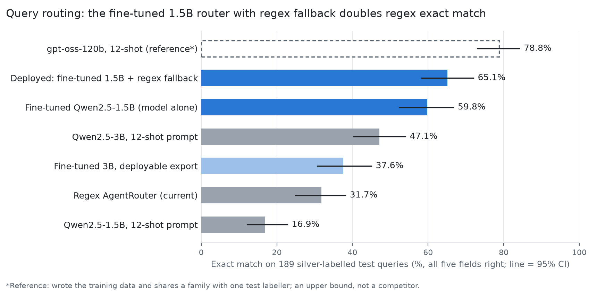

# llm-query-router

**Replacing a regex query router with a fine-tuned 1.5B language model, on an 8 GB MacBook, using only free
tiers. Measured honestly.**

[SatQuery](https://github.com/TanmayShah29/SATQuery-AI) is a satellite-imagery assistant built for Smart
India Hackathon 2026. Every user question is first *routed*: which specialist pipeline runs (change
detection, optical/SAR fusion, SAR or optical question answering, grounding, captioning), which object
categories are involved, what time span, and whether the optical view is blocked so radar is needed. The
original router is a set of regular expressions. This repo is the project that replaced it with a fine-tuned
Qwen2.5-1.5B, from labelling spec to deployment, with the evaluation done carefully enough to trust.



| Router (189 held-out test queries) | exact match [95% CI] | p50 latency, 8 GB M1 |
|---|---|---|
| Regex `AgentRouter` (original) | 31.7 [24.9, 38.1] | 0.17 ms |
| Qwen2.5-3B, prompted with rules + 12 examples | 47.1 [40.2, 54.0] | 3.7 s |
| **Fine-tuned Qwen2.5-1.5B (LoRA)** | **59.8 [52.4, 66.7]** | 1.8 s |
| **Fine-tuned 1.5B + regex fallback (deployed)** | **65.1 [58.2, 72.0]** | 3.4 s |

+33.3 points over regex (95% CI 24.9–41.8, McNemar p = 3e-12). *Exact match* means all five fields of the
decision are right.

> **Caveat, up front:** the test labels are *silver*. Two different LLMs labelled each test query blind and
> only full agreements were kept; no human checked them. So the set is probably easier than real traffic,
> and these numbers are agreement with those labels. The write-up treats this seriously.

## What's in the project

1. **A labelling spec** pinned in code ([GUIDELINES.md](docs/router-ft/GUIDELINES.md),
   [`schema.py`](ml/router_ft/schema.py)) and 20 probe queries showing where regex fails
   ([PROBES.md](docs/router-ft/PROBES.md)).
2. **A fully automatic dataset pipeline** on free API tiers, with a one-button local dashboard
   ([`auto_dataset.py`](ml/router_ft/auto_dataset.py)). The test set was written and labelled before any
   training data existed and frozen by hash; training data comes from a different model, kept only where an
   independent checker agrees; near-duplicates were removed ([DATASET.md](docs/router-ft/DATASET.md)).
3. **An eval harness** with bootstrap confidence intervals, paired McNemar tests, slice and error breakdowns,
   and five baselines including a 120B reference ([`eval.py`](ml/router_ft/eval.py),
   [BASELINES.md](docs/router-ft/BASELINES.md)).
4. **A LoRA fine-tune** of Qwen2.5-1.5B-Instruct (4-bit) with MLX on an M1, about 90 minutes, checkpoint chosen
   on val ([`lora_config.yaml`](ml/router_ft/lora_config.yaml), [MODEL_CARD.md](docs/router-ft/MODEL_CARD.md)),
   plus a 3B QLoRA stretch run on Colab ([`colab/`](ml/router_ft/colab)).
5. **Deployment** behind a feature flag (`ROUTER_BACKEND=llm`) with schema validation, regex fallback,
   caching and telemetry; regex mode proven unchanged on 2,708 routing plans
   ([`backend/app/agent/`](backend/app/agent), [SERVING.md](docs/router-ft/SERVING.md)).

**Start with [RESULTS.md](docs/router-ft/RESULTS.md)** (results, error analysis, limitations), then
[LOG.md](docs/router-ft/LOG.md): the dated decision log, including everything that went wrong.

## Findings worth knowing

- **Fine-tuning mostly taught the format.** The same 1.5B model scores 16.9% prompted (full rules plus 12
  examples) and 59.8% fine-tuned with a one-line prompt. Prompted, it often knew the intent but broke the
  label vocabulary.
- **The fallback is worth 5 points.** 10% of model outputs were invalid; regex handles those and gets about
  half right, so every served decision is valid.
- **Prompted LLMs ignored a hard UI rule** ("bitemporal pair loaded ⇒ change detection"), scoring 0% in that
  mode. Rule-derived training copies fixed it (78.6% deployed vs regex 57.1%).
- **QLoRA export pitfall.** The 3B scored 66% on val in its Colab training setup but 38% on test as a model you
  can run locally: the adapter had adapted to the exact quantised weights it was trained on. The 1.5B was
  trained and served on the same 4-bit base, adapter unmerged, and lost nothing.

## Repository layout

```
ml/router_ft/          code: schema, dataset pipeline + dashboard, eval harness, routers, training, plots
  routers/             regex adapter, LLM baselines (MLX / Ollama / Groq / llama.cpp), deployed-system adapter
  colab/               run-all notebook for the 3B stretch run
data/router_ft/        probes, guideline examples, test (frozen), train, val, SFT data, pipeline intermediates
results/router_ft/     every run's predictions and metrics, agreement stats, training logs
docs/router-ft/        RESULTS, LOG, GUIDELINES, DATASET, BASELINES, MODEL_CARD, SERVING, figures, HF card drafts
backend/               the slice of the SatQuery backend this project touches (see "What's from SatQuery")
```

## Run it

Requires macOS on Apple silicon for MLX, and [uv](https://docs.astral.sh/uv/).

```bash
cd ml/router_ft
uv sync
uv run python eval.py run --name regex --router regex     # regex baseline on the test set and probes
uv run python eval.py report                               # rebuilds docs/router-ft/BASELINES.md
```

Retraining (about 90 minutes on an 8 GB M1; downloads the 4-bit base, about 1 GB):

```bash
uv run python prepare_sft.py && uv run mlx_lm.lora -c lora_config.yaml
uv run python select_checkpoint.py adapters/qwen1.5b-r8
uv run python eval.py run --name ft-qwen1.5b-r8 --router mlx --model mlx-community/Qwen2.5-1.5B-Instruct-4bit --adapter adapters/qwen1.5b-r8-best --prompt sft
```

The trained adapter isn't in git (it's a model artifact). Rebuilding the dataset needs a free Groq key and a
free OpenRouter key in `backend/.env` (`GROQ_API_KEY`, `OPENROUTER_API_KEY`), then
`uv run python ui.py` and press Start.

Backend slice tests (mocked model server):

```bash
cd backend && pip install -r requirements.txt && python -m pytest tests -q
```

## What's from SatQuery

`backend/app/config.py`, `backend/app/agent/router.py` (the original regex `AgentRouter`, plus this project's
small `decide()` refactor) and `backend/app/models/registry.py` come from the
[SatQuery app](https://github.com/TanmayShah29/SATQuery-AI) by Team Divya Drishti. They're included so the regex
baseline and the integration can be reproduced, and they're not covered by this repo's licence.
`backend/app/agent/llm_router.py` and its tests are new in this project. The full app integration (query
service, `/api/health` telemetry) lives in the SatQuery repo on the `router-finetune` branch.

## Licence

MIT for this project's own code and docs (see [LICENSE](LICENSE)), except the SatQuery files listed above.
The datasets are synthetic, written and labelled by `gpt-oss-120b`, `gpt-oss-20b`, `qwen3.8-27b` and Nemotron
Ultra through free API tiers; check those models' output terms before reusing them commercially. The base
model, Qwen2.5-1.5B-Instruct, is Apache-2.0.
